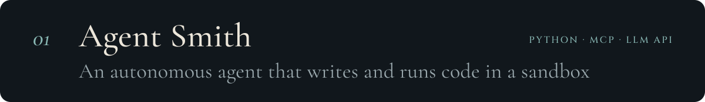
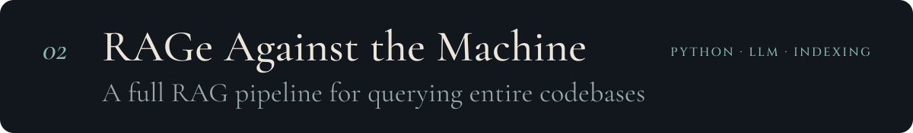
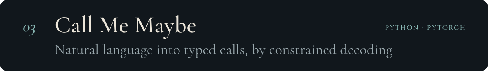
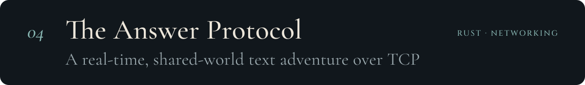
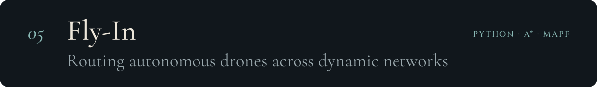
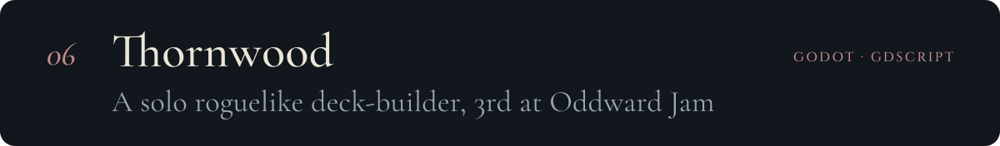
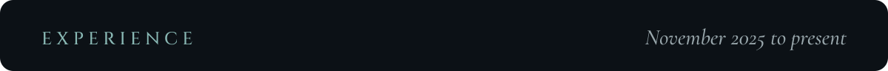
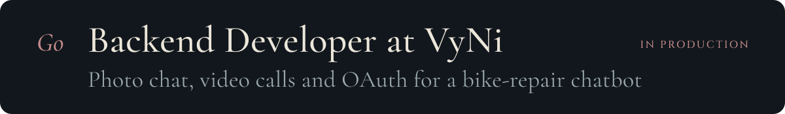
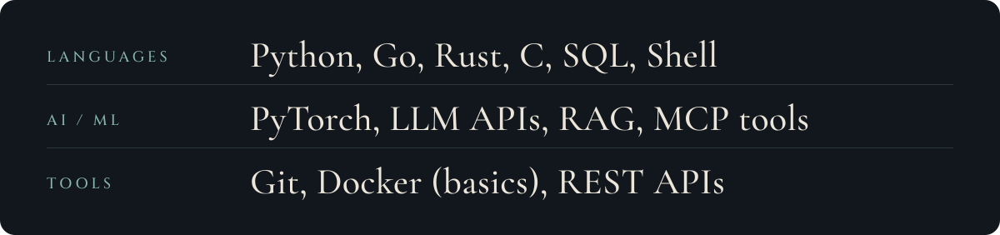

  I build at the meeting point of AI and backend systems: LLM tooling, RAG pipelines, autonomous agents and low-level programming. Student at 42 Le Havre, where learning happens by shipping.

  <a href="https://mosmond.dev"><b>mosmond.dev</b></a> &nbsp;·&nbsp;
  <a href="https://www.linkedin.com/in/maxence-osmond"><b>LinkedIn</b></a> &nbsp;·&nbsp;
  <a href="mailto:osmondmaxence@gmail.com"><b>osmondmaxence@gmail.com</b></a>

